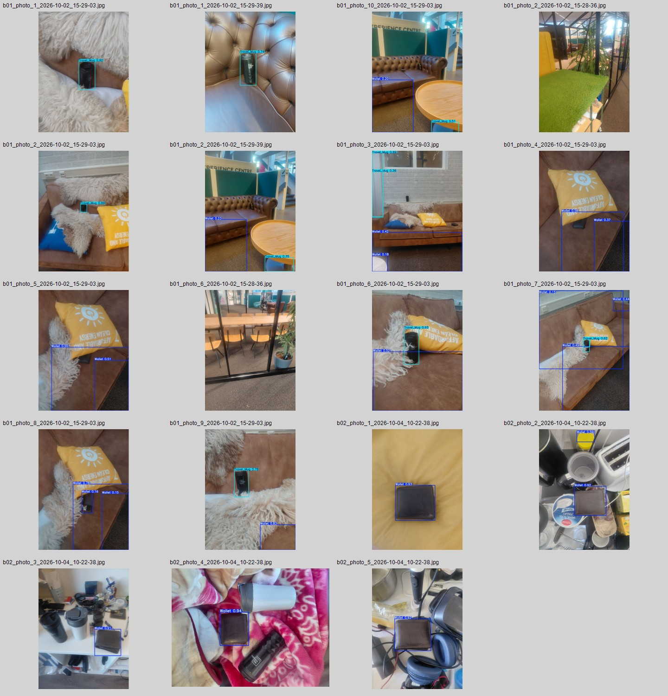

# FindMine: Wallet and Travel Mug Detection

> Work in progress

FindMine is an object-detection experiment for locating a wallet and a lidded travel
mug in cluttered indoor scenes. The current work focuses on dataset quality: keeping
near-duplicate camera views out of different splits, collecting difficult examples,
and checking where the detector fails before increasing the dataset size.



## Current dataset

The internal dataset has 231 labelled images from several capture sessions. It is
not included in this repository. Scene groups, rather than individual images, are
assigned to train, validation, and test sets.

| Split | Images | Wallet boxes | Travel mug boxes |
|---|---:|---:|---:|
| Train | 194 | 125 | 146 |
| Validation | 18 | 8 | 10 |
| Test | 19 | 10 | 13 |

This grouped split matters because a random image split can place almost identical
views in both training and validation data. That gives an optimistic result without
showing whether the model generalises to a new scene.

## Experiments so far

The values below are validation metrics at the epoch with the highest mAP50 in each
run. They are useful for tracking experiments, but the validation set is still too
small for a final model comparison.

| Run | Best epoch | Precision | Recall | mAP50 | mAP50-95 |
|---|---:|---:|---:|---:|---:|
| v2 grouped baseline | 30 | 0.894 | 0.734 | 0.782 | 0.678 |
| v4 public supplement | 44 | 0.891 | 0.803 | 0.824 | 0.680 |
| v5 own-image fine-tune | 1 | 0.893 | 0.773 | 0.839 | 0.689 |

The qualitative review still shows false positives on sofas, cushions, and other
rectangular or textured objects. The next dataset version adds small, rotated,
partly hidden wallets and rebuilds every split by scene before a final test run.

## Repository layout

```text
configs/   example YOLO dataset configuration
data/      dataset counts and publication notes
docs/      experiment decisions and current work
results/   validation summaries and qualitative review
scripts/   split, train, evaluate, predict, and reporting commands
src/       reusable scene-grouping code
tests/     tests for split integrity and experiment reporting
```

Model checkpoints, raw images, videos, class notebooks, and duplicated training
outputs are intentionally excluded.

## Setup

```bash
python -m venv .venv
# Windows: .venv\Scripts\activate
# macOS/Linux: source .venv/bin/activate
pip install -r requirements.txt
```

## Rebuild the grouped split

```bash
python scripts/make_grouped_split.py /path/to/source_dataset /path/to/new_dataset
```

Supplemental files without a FindMine capture name are kept in training only. The
script refuses to overwrite an existing destination.

## Train and evaluate

```bash
python scripts/train.py \
  --data /path/to/new_dataset/data.yaml \
  --model yolo11s.pt \
  --name grouped-baseline \
  --epochs 50

python scripts/evaluate.py \
  --weights runs/grouped-baseline/weights/best.pt \
  --data /path/to/new_dataset/data.yaml \
  --split test
```

The test split should only be used after the model, training choices, and confidence
threshold have been fixed.

## Run the lightweight tests

```bash
python -m unittest discover -s tests -v
```

See the [experiment log](docs/experiment-log.md) for what changed between runs and
the limitations that still need to be addressed.

