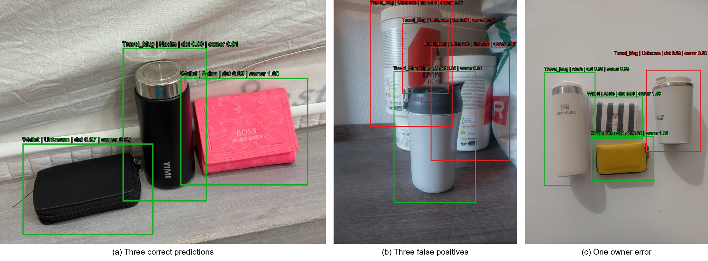

# FindMine: Personal Object and Owner Recognition

FindMine is a two-stage computer-vision pipeline for locating personal objects and
identifying their registered owners in real-world indoor scenes. A YOLO11s detector
first localizes wallets and travel mugs. The detected crop is then passed to a
transfer-learned ResNet18 classifier, which predicts a registered owner or rejects the
item as `Unknown`.

This repository is a cleaned public release of a completed course project. Raw images,
owner-labelled crops, model checkpoints, and personal data are intentionally excluded.



## Research question

> How accurately can a YOLO11s detector combined with transfer-learned classifiers
> identify both the category and owner of wallets and travel mugs in real-world images?

## Pipeline

```text
Input image -> YOLO11s detector -> object crop -> ResNet18 classifier -> owner or Unknown
```

The detector and owner classifiers were evaluated separately before the complete
pipeline was tested. Ground-truth crops were used for classifier comparison so that
detection errors did not influence model selection.

## Dataset and split

The detection dataset contained 280 images: 267 photographs collected for the project
and 13 externally sourced wallet images. Near-duplicate views were grouped by scene
before splitting to reduce leakage.

| Split | Images | Objects | Background-only images |
|---|---:|---:|---:|
| Train | 208 | 244 | 26 |
| Validation | 40 | 52 | 1 |
| Test | 32 | 50 | 1 |

The 49 training-only support images included 36 project photographs and 13 external
images. Detector validation and test images came only from the five photographed
batches.

Owner classification used separate datasets for each object category:

| Object | Train crops | Validation crops | Test crops | Registered owners |
|---|---:|---:|---:|---:|
| Travel mug | 156 | 40 | 41 | 8 + Unknown |
| Wallet | 166 | 34 | 29 | 6 + Unknown |

## Final results

### Object detection

| Precision | Recall | mAP@0.5 | mAP@0.5:0.95 |
|---:|---:|---:|---:|
| 0.840 | 0.696 | 0.828 | 0.752 |

Wallet and travel-mug mAP@0.5 were 0.890 and 0.765, respectively.

### Owner classification

| Object | Model | Validation macro-F1 | Test accuracy | Test macro-F1 |
|---|---|---:|---:|---:|
| Travel mug | ResNet18 | 0.887 | 0.927 | 0.943 |
| Travel mug | MobileNetV3-Small | 0.705 | 0.854 | 0.815 |
| Wallet | ResNet18 | 1.000 | 0.966 | 0.984 |
| Wallet | MobileNetV3-Small | 0.968 | 1.000 | 1.000 |

ResNet18 was selected because it gave the strongest validation macro-F1 for both object
types.

### End-to-end evaluation

The detection threshold was selected on validation data and fixed at 0.88 for the final
test. Matches required IoU >= 0.5, and owner predictions below 0.50 were rejected.

| Metric | Result |
|---|---:|
| Ground-truth objects | 50 |
| Correct category and owner | 36 (72%) |
| Owner errors after a correct match | 3 |
| Missed objects | 11 |
| False-positive detections | 7 |
| Conditional owner accuracy | 0.923 |
| End-to-end precision | 0.783 |
| End-to-end recall | 0.720 |
| End-to-end F1 | 0.750 |

Detection was the main bottleneck. The model missed 11 objects and produced seven false
positives, including mug-like background objects. Owner recognition was usually correct
once an object had been localized.

## Repository layout

```text
configs/   example YOLO dataset configuration
data/      dataset publication notes
docs/      methodology and experiment history
paper/     final extended abstract
results/   final metrics and qualitative results
scripts/   data splitting, training, inference, and evaluation
src/       reusable dataset utilities
tests/     lightweight checks for the public code
```

## Installation

```bash
python -m venv .venv
# Windows: .venv\Scripts\activate
# macOS/Linux: source .venv/bin/activate
pip install -r requirements.txt
```

## Training

```bash
python scripts/train.py \
  --data /path/to/detection_dataset/data.yaml \
  --model yolo11s.pt \
  --name findmine-detector \
  --epochs 100 \
  --batch 16 \
  --patience 20

python scripts/train_owner_classifier.py \
  --data /path/to/wallet_owner_dataset \
  --arch resnet18 \
  --output runs/wallet-resnet18
```

The owner-classifier command also supports `--arch mobilenet_v3_small`.

## End-to-end inference

```bash
python scripts/run_findmine_pipeline.py \
  --source /path/to/images \
  --detector /path/to/detector.pt \
  --wallet-model /path/to/wallet_classifier.pt \
  --mug-model /path/to/mug_classifier.pt \
  --output runs/pipeline \
  --det-conf 0.88 \
  --owner-conf 0.50
```

## Limitations

- The number of physical objects and participants was small.
- Repeated views remain present even though scene grouping prevents split leakage.
- The supervised `Unknown` class is a practical rejection mechanism, not formal
  open-set recognition.
- Externally sourced unknown crops may introduce dataset-specific visual cues.
- The results demonstrate a proof of concept rather than broad generalization.

## Tests

```bash
python -m unittest discover -s tests -v
```

The final extended abstract is available in [`paper/`](paper/).
